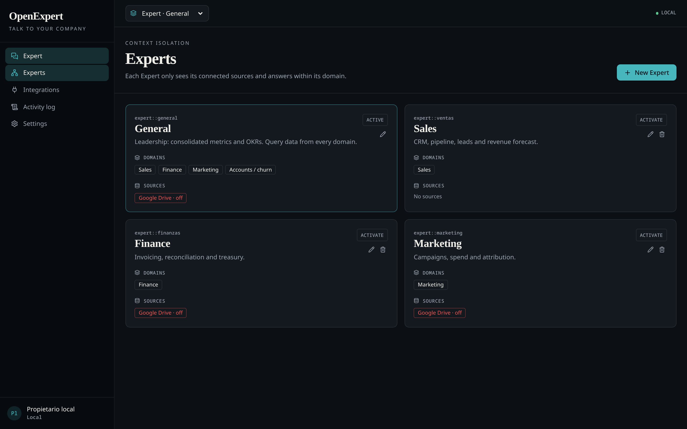
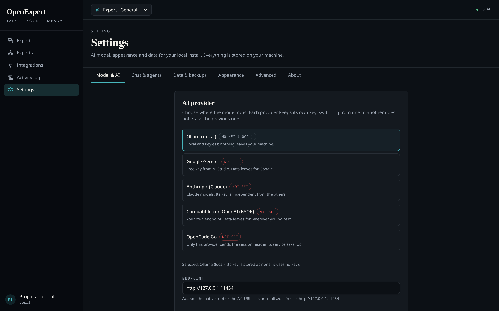

# OpenExpert

**Talk to your company — with your data on your machine.**

OpenExpert is a local-first AI operations dashboard: Experts with isolated data,
a chat that uses tools, and actions that need your approval before anything
changes. One SQLite file, your own model, no accounts and no cloud service.

It runs with Ollama by default. If you prefer, you can connect Gemini, Claude or
any OpenAI-compatible endpoint; the database stays local either way.

Open source under the MIT license.

> The Spanish version of this document is [`README.es.md`](./README.es.md).

[](./LICENSE)
[](https://nodejs.org)
[](https://www.npmjs.com/package/@openexpert/openexpert)
[](https://github.com/OpenExpert-ai/OpenExpert/releases)
[](.github/workflows/codeql.yml)
[](https://scorecard.dev/viewer/?uri=github.com/OpenExpert-ai/OpenExpert)



## Why OpenExpert

- **Isolation by design.** Each Expert only sees the domains and sources it is
  allowed to; no Expert can read another's data.
- **Nothing changes without you.** The assistant proposes, you approve, and
  every revertible change is logged with a snapshot and can be reverted.
- **Local by default.** One SQLite file, no accounts, no database server. Ollama
  runs on your machine; Gemini, Claude or any OpenAI-compatible endpoint are
  optional.

## What you can ask

- "How is the sales pipeline doing?"
- "Collect overdue invoices over €5,000."
- "Pause campaigns with a high CPA."
- "Create a new Expert for Operations."

The assistant answers from the data you connect (Google Drive, local folders,
Notion) or your CRM and accounting (Pipedrive, Holded, or a CSV) and proposes
writes instead of performing them.



## Quick start

Full guide: [docs/en/00-quickstart.md](./docs/en/00-quickstart.md).

### Docker (no Node required)

The app has no login: keep it on `127.0.0.1` (see [docker/README.md](./docker/README.md)).

```sh
docker run --rm -p 127.0.0.1:3000:3000 -v openexpert-data:/data ghcr.io/openexpert-ai/openexpert:latest
```

Or, from a clone, bring Ollama along:

```sh
docker compose -f docker/docker-compose.yml up -d
docker compose -f docker/docker-compose.yml exec ollama ollama pull llama3.1
```

### With Node

```sh
npx @openexpert/openexpert          # interactive setup, then starts
npx @openexpert/openexpert serve    # start directly
```

Scaffold a project:

```sh
npm create openexpert my-app && cd my-app && docker compose up -d
```

### From source

```sh
git clone https://github.com/OpenExpert-ai/OpenExpert.git
cd OpenExpert
npm ci
npm run dev                       # http://localhost:3000
```

The dev server is pinned to **port 3000** because the Google Drive OAuth
redirect URI depends on it.

### Desktop app (Linux)

OpenExpert can also run as a native window opened by a single command, installed
for the current user (needs Rust and the WebKitGTK 4.1 libraries; the per-distro
packages are in [Deployment](./docs/en/08-deployment.md#6-desktop-application-linux)):

```sh
npm run desktop:install    # build + install the launcher
openexpert                 # start the server and open the window
```

Or install everything (dependencies, build, launcher, menu entry) with one
command:

```sh
./install.sh              # asks for the model provider; --with-ollama installs Ollama + llama3.1
```

See [Deployment](./docs/en/08-deployment.md).

## How it works

- **Data** lives in a single SQLite file at `OPENEXPERT_DATA_DIR/openexpert.db`
  (default `~/.openexpert/`). The database never leaves your machine.
- **AI** is configuration: [Ollama](https://ollama.com) (default, no keys) runs
  locally; Google Gemini, Claude or any OpenAI-compatible endpoint are optional.
  With Ollama, prompts stay local too; with an external provider, the prompt
  goes to that provider. See
  [docs/en/13-ai-providers.md](./docs/en/13-ai-providers.md).
- **Sources** (optional): Google Drive, local folders and Notion, connected with
  your own account; tokens and grants are stored locally with mode `0600`.
- **Business data**: import a CSV (deals, invoices, campaigns or accounts) or
  connect Pipedrive and Holded with your own API key; both are optional. The
  sample dataset in Settings → Data lets you try the dashboard before connecting.
- **Governance**: every revertible change is logged with a snapshot and can be
  reverted from the activity screen. AI actions are only _proposed_ and need
  human approval.
- **Settings** live in a panel (`/settings`): model & AI, chat, data backups,
  appearance and advanced options — in Spanish or English. Changes apply without
  restarting.

## Documentation

The full documentation lives in **[`docs/`](./docs/README.md)** (English and
Spanish).

| Document                                         | Content                                |
| ------------------------------------------------ | -------------------------------------- |
| [Quickstart](./docs/en/00-quickstart.md)         | From zero to chatting in 5 minutes     |
| [Product](./docs/en/01-product.md)               | What the platform does                 |
| [Architecture](./docs/en/02-architecture.md)     | Layers and data flow                   |
| [Data model](./docs/en/03-data-model.md)         | SQLite tables                          |
| [Security](./docs/en/04-security.md)             | Access and protections                 |
| [AI](./docs/en/05-ai.md)                         | Assistant tools and limits             |
| [Integrations](./docs/en/06-integrations.md)     | Google Drive, local folders and Notion |
| [Development](./docs/en/07-development.md)       | Environment, scripts, conventions      |
| [Deployment](./docs/en/08-deployment.md)         | Running locally and with Docker        |
| [Operation](./docs/en/09-operation.md)           | Recurring tasks and diagnosis          |
| [Glossary](./docs/en/10-glossary.md)             | Vocabulary                             |
| [Engine and CLI](./docs/en/11-engine-and-cli.md) | The package and its CLI (MIT)          |
| [Licensing model](./docs/en/12-licensing.md)     | MIT, obligations, monetisation         |
| [AI providers](./docs/en/13-ai-providers.md)     | Ollama, Gemini and BYOK                |
| [Roadmap](./docs/en/14-roadmap.md)               | Status and planning                    |

## Requirements

- Node.js 24 or later (includes npm 11).
- Docker, optional, for the container path.
- For the desktop app: Rust and WebKitGTK 4.1 — see
  [Deployment](./docs/en/08-deployment.md#6-desktop-application-linux).

## Layout

The paths you will touch most:

```
src/routes/          TanStack Router routes
src/lib/             server functions, SQLite, AI tools, integrations
packages/openexpert/ MIT engine and CLI
docker/              Dockerfile and Compose
docs/{en,es}/        bilingual documentation
src-tauri/           desktop window (Tauri)
```

The full tree is in [Development](./docs/en/07-development.md).

## Status

OpenExpert is **pre-1.0 (0.5.x)**. Interfaces and the data model may change
between minor versions. The [roadmap](./docs/en/14-roadmap.md) tracks what is
next.

## Contributing

Issues and pull requests are welcome. [`CONTRIBUTING.md`](./CONTRIBUTING.md)
explains the DCO and the gates; the development setup is in
[`docs/en/07-development.md`](./docs/en/07-development.md). Support is
community-based and has no SLA: see [`SUPPORT.md`](./SUPPORT.md).

## Notes

- Single owner: there is no login and no multi-user management. Keep the server
  on `127.0.0.1` unless you put it behind a proxy and a firewall.
- `.env` is git-ignored; `.env.example` documents the environment variables you
  normally set.
- The whole repository is released under the **MIT License**. See
  [`LICENSE`](./LICENSE) and [`NOTICE`](./NOTICE).
- Backups are downloaded encrypted with a passphrase you choose; losing it means
  losing the copy. The data directory is created `0700` and the database `0600`.
- Windows and macOS desktop packages are built unsigned in CI; Linux is the
  tested desktop path.
- [`SECURITY.md`](./SECURITY.md) describes the private channel for reporting
  vulnerabilities.
- [`PRIVACY.md`](./PRIVACY.md) is the privacy policy (Spanish:
  [`docs/es/POLITICA-DE-PRIVACIDAD.md`](./docs/es/POLITICA-DE-PRIVACIDAD.md)).
